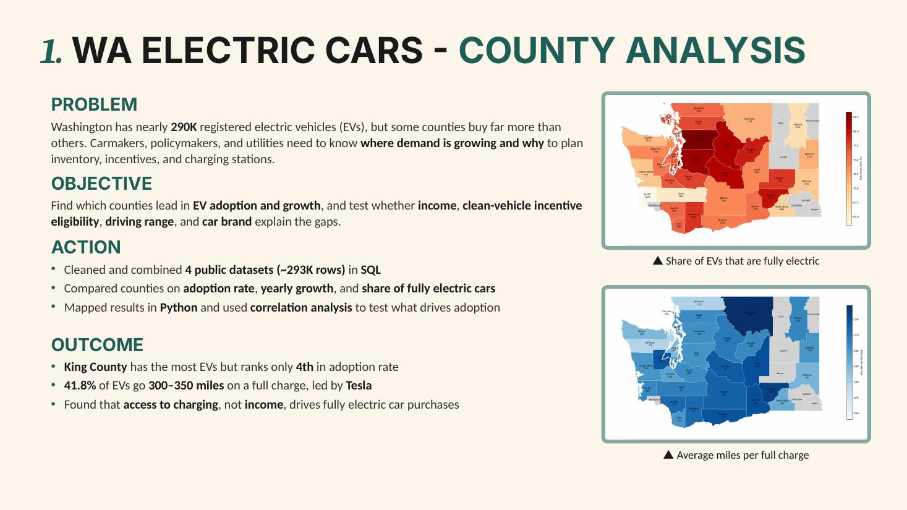

# Project Portfolio Slide Skill

A Claude skill that turns your past project materials (slide decks, reports, code, notebooks, spreadsheets, screenshots, notes) into a **recruiter-ready, one-page 16:9 PowerPoint slide** per project. It can also combine several slides into one portfolio deck.

Built for business-school and analytics students applying to Business Analyst, BI Engineer, Data Analyst and Financial Analyst roles.



## What you get

Each slide follows the same layout:

- **Title**: project name with a two-tone ending
- **Problem** (2 sentences), **Objective** (1 sentence)
- **Action**: 3 one-line bullets that name the tool or method
- **Outcome**: 2-3 one-line bullets, one number each
- **Two framed visuals** on the right: your own charts or screenshots, a simple chart rebuilt from your numbers, or a diagram

Claude only uses what is in your materials. It will not invent numbers or results. Anything missing is left as a clearly marked placeholder, and Claude lists every number it used and where it came from.

## Install

Download [`project-portfolio-slide.zip`](https://github.com/dephinefan25-coder/portfolio-slide-skill/raw/main/project-portfolio-slide.zip) from this repo (or zip the `project-portfolio-slide` folder yourself).

**Claude.ai (web / desktop app)**

1. Go to **Settings > Capabilities** and make sure code execution is turned on.
2. Under **Skills**, click **Upload skill** and choose `project-portfolio-slide.zip`.
3. Turn the skill on.

**Claude Code**

Copy the folder into your skills directory:

```bash
git clone https://github.com/dephinefan25-coder/portfolio-slide-skill.git
cp -r portfolio-slide-skill/project-portfolio-slide ~/.claude/skills/
```

## Use

Start a new chat, attach your project files, and ask something like:

> Make a portfolio slide for this project. Target roles: Data Analyst, BA.

Then review the slide and ask for changes ("shorten the Problem", "use my dashboard screenshot as visual 1"). For a full deck:

> Combine my finished slides into one portfolio deck, numbered 1 to N.

## What's in the folder

| File | Purpose |
|---|---|
| `SKILL.md` | The instructions Claude follows (content rules, style spec, checks) |
| `fix.py` | Cleans up bullet formatting in the generated PPTX |
| `examples/make_ev_example.js` (+ `ev_share.png`, `ev_range.png`) | **Example only.** The build script for the author's own project, used as a layout reference. Your slide will use your own content. |
| `examples/example_preview.jpg` | Preview of that example slide |

## Tips

- More material gives better slides: include results tables, charts and your own notes on what you did.
- For group projects, the skill writes one story without naming teammates. Check that the role wording ("Led" vs. "Contributed to") is honest for your part.
- Always read the final slide yourself before sending it to a recruiter.
